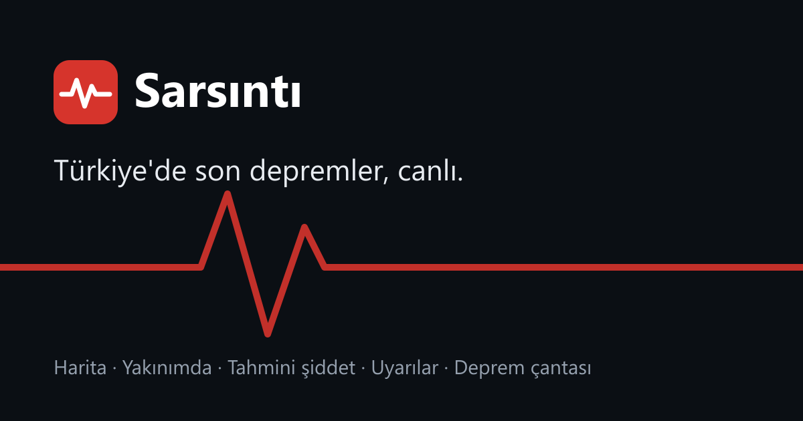

# Sarsıntı

**Türkiye için canlı deprem takibi.** Son depremleri haritada gör, yakınındaki sarsıntıları ve bulunduğun yerde tahmini şiddeti öğren, büyük bir deprem olduğunda uyarı al, deprem çantanı ve aile planını hazırla.

🔗 **https://necatimertmetin.github.io/sarsinti/**



## Neler var

| Bölüm | Ne yapar |
| --- | --- |
| **Canlı** | Son 24 saat / 7 gün / 30 günün depremleri harita ve listede. Büyüklüğe göre filtre, il/bölge araması. Yeni depremler EMSC'nin canlı bağlantısıyla (WebSocket) birkaç saniyede düşer; ayrıca dakikada bir yenilenir. Son 1 saatteki depremler haritada nabız gibi atar. |
| **Deprem ayrıntısı** | Türkçe konum ("Malatya'nın 12 km kuzeybatısı"), derinlik, kaynak kurum, sana uzaklığı, bulunduğun yerde tahmini şiddet, depremin hissedilmiş olabileceği iller. Paylaşılabilir bağlantı (`#/deprem/<id>`). |
| **Yakınım** | Konumunu (ya da bir ili) seç; 25–200 km içindeki depremler, en büyüğü, en yakını ve sana en çok sallantı yaşatmış olanı. Konum sadece cihazda saklanır. |
| **Uyarılar** | Seçtiğin büyüklüğün üzerindeki yeni depremlerde ekranda uyarı, isteğe bağlı ses ve sistem bildirimi. "Sadece yakınımdakiler" seçeneği. |
| **İstatistik** | Son 30 günde günlük deprem sayısı, büyüklük dağılımı, en hareketli iller, toplam açığa çıkan enerji ve Gutenberg–Richter b-değeri. |
| **Hazırlık** | Tek dokunuşla "İyiyim, güvendeyim" mesajı (isteğe bağlı konumla), AFAD önerilerine göre deprem çantası kontrol listesi, paylaşılabilir aile planı, deprem öncesi/anı/sonrası rehberi. |

Uygulama bir PWA: telefonda "Ana ekrana ekle" ile uygulama gibi açılır, koyu/açık tema destekler.

## Veri

- **EMSC** (European-Mediterranean Seismological Centre) FDSN servisi ve canlı WebSocket akışı. Türkiye'deki depremler için Kandilli Rasathanesi (KOERI) ve AFAD çözümlerini içerir, küçük depremler dahil.
- **USGS** yedek kaynak: EMSC'ye ulaşılamazsa M2.5 ve üzeri depremler USGS'ten çekilir.
- Harita: © OpenStreetMap katkıcıları.

Sunucu yok: tarayıcı veriyi doğrudan bu açık servislerden alır (ikisi de CORS destekler), uygulama GitHub Pages'te statik olarak yayınlanır.

**Tahmini şiddet**, Atkinson & Wald (2007) şiddet tahmin bağıntısıyla hesaplanır; zemine ve binaya göre gerçekte hissedilen farklı olabilir. Sarsıntı bir **erken uyarı sistemi değildir**; resmî bilgi için AFAD'ı takip edin.

## Geliştirme

```bash
npm install
npm run dev      # http://localhost:5173/sarsinti/
npm test         # vitest, 41 test
npm run build    # dist/
```

Teknoloji: React 19, TypeScript, Vite, Leaflet, Vitest + Testing Library. `main` dalına her push'ta GitHub Actions testleri çalıştırır ve siteyi GitHub Pages'e yayınlar.

```
src/
  lib/          veri kaynakları, coğrafya (81 il, Türkçe yön/ek), şiddet, istatistik, uyarılar
  hooks/        useQuakes (yükleme + WebSocket + yoklama), useStored (localStorage)
  components/   harita, liste, ayrıntı, Yakınım, İstatistik, Hazırlık, uyarı ayarları
public/         PWA manifest, service worker, ikonlar
```

## Lisans

MIT
